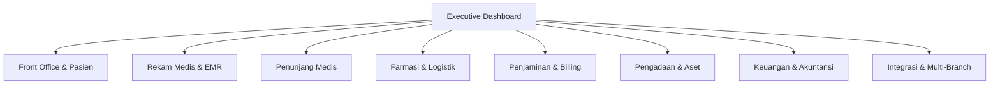

# 🏥 SIMRS Medika — Enterprise Hospital ERP Frontend Template

[](https://react.dev/)
[](https://www.typescriptlang.org/)
[](https://vitejs.dev/)
[](https://tailwindcss.com/)
[](https://ui.shadcn.com/)
[](https://satusehat.kemkes.go.id/)

Template frontend modern siap pakai untuk **Sistem Informasi Manajemen Rumah Sakit (SIMRS) / Hospital ERP Enterprise**. Dirancang dengan arsitektur modular berskala besar, performa tinggi, desain antarmuka klinis yang ergonomis, serta kesiapan integrasi standar regulasi kesehatan Indonesia (PMK 24/2022 RME, BPJS VClaim, SatuSehat HL7/FHIR, INA-CBG, dan SIPNAP).

---

## 📑 Daftar Isi
- [Gambaran Umum](#-gambaran-umum)
- [Teknologi Utama](#-teknologi-utama)
- [Daftar Modul & Fitur](#-daftar-modul--fitur)
- [Struktur Direktori](#-struktur-direktori)
- [Path Aliases](#-path-aliases)
- [Prasyarat Sistem](#-prasyarat-sistem)
- [Instalasi & Menjalankan Proyek](#-instalasi--menjalankan-proyek)
- [Konfigurasi Environment & Proxy API](#-konfigurasi-environment--proxy-api)
- [Panduan Pengembangan (Usage Guide)](#-panduan-pengembangan-usage-guide)
  - [1. Cara Menambahkan Modul Baru](#1-cara-menambahkan-modul-baru)
  - [2. Cara Menambahkan Halaman ke Routing & Sidebar](#2-cara-menambahkan-halaman-ke-routing--sidebar)
  - [3. Menggunakan Komponen Reusable](#3-menggunakan-komponen-reusable)
  - [4. Integrasi State Management (Zustand)](#4-integrasi-state-management-zustand)
  - [5. Integrasi Pemanggilan API Backend](#5-integrasi-pemanggilan-api-backend)
- [Standar Regulasi Kesehatan](#-standar-regulasi-kesehatan)
- [Skrip Tersedia](#-skrip-tersedia)
- [Lisensi](#-lisensi)

---

## 🌟 Gambaran Umum

Template ini dibangun untuk menjawab tantangan kompleksitas sistem rumah sakit tingkat lanjut (Rumah Sakit Tipe A, B, C, D, maupun Jaringan Rumah Sakit Multi-Cabang):

- **Arsitektur Domain-Driven**: Modul dikelompokkan secara terisolasi per domain bisnis (`front-office`, `emr`, `penunjang`, `farmasi`, `billing`, `pengadaan`, `keuangan`, `integrasi`).
- **Lazy Route Loading**: Setiap modul dan sub-halaman dimuat secara on-demand menggunakan React dynamic import (`React.lazy`), menjaga beban awal aplikasi tetap ringan.
- **Standar Antarmuka Modern**: Dibangun di atas Tailwind CSS v4 dan shadcn/ui dengan palet warna OKLCH, responsif, dan siap mode terang/gelap (Dark Mode).
- **Komponen Klinis Kaya Visual**: Dilengkapi visualisasi Bed Occupancy Rate (BOR), Triase ESI berkode warna, bagan Rekam Medis CPPT SOAP, LIS Analyzer Status, FEFO Drug Inventory, dan visualisasi konsolidasi multi-cabang dengan Recharts.

---

## 🛠️ Teknologi Utama

| Layer | Pilihan Teknologi | Versi | Keterangan |
|---|---|---|---|
| **Core Framework** | React + TypeScript | React 19.x / TS 5.9.x | Strict type safety & modern React features |
| **Bundler & Build Tool** | Vite + `@vitejs/plugin-react-swc` | Vite 7.x | Kompilasi SWC super cepat & Hot Module Replacement (HMR) |
| **Styling & Design System** | Tailwind CSS v4 + OKLCH Tokens | 4.1.x | Utility CSS performa tinggi dengan variabel warna CSS modern |
| **UI Components** | shadcn/ui + Radix UI Primitives | Latest | Komponen UI accessible, accessible dialogs, dropdowns, tables, drawers |
| **Icons & Charts** | `lucide-react` & `recharts` | Latest | Ikon medis lengkap & visualisasi data analitik rumah sakit |
| **Routing** | React Router DOM | v7.x | Dynamic layout routing, breadcrumbs otomatis, parameter navigasi |
| **Forms & Validation** | React Hook Form + Zod | Latest | Validasi skema data klinis & form registrasi |
| **State Management** | Zustand | v5.x | Global state ringan (tema, user auth, active branch) |
| **HTTP Client** | Axios | Latest | Komunikasi RESTful API dengan proxy environment |

---

## 🏥 Daftar Modul & Fitur

Aplikasi ini mencakup 9 domain inti SIMRS dengan total 24+ halaman fungsional:



### 1. Executive Dashboard (`/dashboard`)
- KPI Operasional Utama: Angka Kunjungan Hari Ini, BOR (*Bed Occupancy Rate*), Pasien IGD Aktif, Pendapatan Berjalan.
- Grafik Tren Kunjungan Harian (Rawat Jalan, Rawat Inap, IGD).
- Payer Mix Chart: Proporsi Penjamin Pasien (BPJS, Asuransi Swasta, Umum, Korporasi/PKS).
- Okupansi Tempat Tidur per Kelas Perawatan (VIP, Kelas 1, 2, 3, ICU/NICU).
- Sistem Peringatan Dini Operasional (*Critical Stock Alert*, Kalibrasi Alat, Klaim Tertunda, Sinkronisasi SatuSehat).

### 2. Front Office & Pasien (`/front-office/*`)
- **Pendaftaran & Admisi (`/pendaftaran`)**: Registrasi pasien baru/lama, verifikasi NIK otomatis via Dukcapil, status kepesertaan BPJS, alur ADT (*Admission, Discharge, Transfer*).
- **Antrean Poli (`/antrean`)**: Monitoring antrean loket & poli, integrasi antrean kiosk fisik dan mobile app pasien, kontrol panggil/lewati antrean, layar display antrean.
- **Rawat Inap & Bed (`/rawat-inap`)**: Peta Bed interaktif real-time (status: Tersedia, Terisi, Perlu Pembersihan/Housekeeping, Maintenance), alokasi bed, mutasi kelas/kamar, monitoring ALOS (*Average Length of Stay*).
- **Jadwal & Kuota Dokter (`/jadwal-dokter`)**: Kalender praktik dokter spesialis mingguan, batas kuota pasien per sesi, booking janji temu (*appointment*).

### 3. Rekam Medis & Klinis (`/emr/*`)
- **Rekam Medis Elektronik (`/rekam-medis`)**: Sesuai PMK 24/2022. Catatan Perkembangan Pasien Terintegrasi (CPPT) berformat SOAP (DPJP, Perawat, Tenaga Medis Lain), pencatatan tanda vital, riwayat alergi, pengkodean ICD-10 (diagnosis utama/sekunder) dan ICD-9-CM (tindakan).
- **IGD & Triase (`/igd`)**: Klasifikasi triase 4 tingkat (Merah/Resusitasi, Kuning/Urgen, Hijau/Non-Urgen, Hitam/DOA), pencatatan skor GCS, vital sign darurat, waktu tunggu *door-to-doctor*.
- **Kamar Bedah / OK (`/kamar-bedah`)**: Penjadwalan operasi, status ruang OK/Cathlab, *Surgical Safety Checklist* standar WHO (Sign In, Time Out, Sign Out), checklist pre-operasi, kesiapan instrumen CSSD steril.

### 4. Penunjang Medis (`/penunjang/*`)
- **Laboratorium / LIS (`/laboratorium`)**: Manajemen sampel berbarcode, integrasi analyzer otomatis (Sysmex, Cobas), input nilai hasil & rentang rujukan, verifikasi dokter patologi klinik, penanganan nilai kritis (*panic values*).
- **Radiologi / RIS & PACS (`/radiologi`)**: Worklist modalitas (CT-Scan, MRI, X-Ray, USG), viewer simulasi citra DICOM, input hasil ekspertise dokter spesialis radiologi (Sp.Rad).
- **Bank Darah & CSSD (`/bank-darah-cssd`)**: Stok kantong darah (BDRS) per golongan darah dan rhesus, hasil uji silang serasi (*crossmatch*), sterilisasi instrumen CSSD (autoclave/plasma) dengan nomor batch & masa kedaluwarsa steril.

### 5. Farmasi & Logistik (`/farmasi/*`)
- **E-Resep & Telaah (`/resep`)**: Penerimaan resep elektronik otomatis dari dokter, telaah resep 7-Benar, skrining otomatis interaksi obat & alergi pasien, antrean peracikan & cetak etiket aturan pakai.
- **Stok, Batch & FEFO (`/inventori`)**: Manajemen persediaan obat & BMHP berbasis FEFO (*First Expired First Out*) & FIFO, pemantauan tanggal kedaluwarsa, buffer stock, *Reorder Point* (ROP), stok opname.
- **Narkotika & Psikotropika (`/narkotika`)**: Buku register narkotika digital, kartu stok khusus, integrasi pelaporan SIPNAP Kemenkes, log akses lemari khusus berpintu ganda.
- **Depo & Distribusi (`/depo`)**: Distribusi obat metode *Unit Dose Dispensing* (UDD), floor stock, mutasi/transfer obat antar depo (Depo Rajal, Depo Ranap, Depo IGD, Depo OK).

### 6. Penjaminan & Billing (`/billing/*`)
- **Eligibilitas & SEP (`/eligibilitas`)**: Bridging BPJS VClaim (pembuatan Surat Eligibilitas Peserta / SEP otomatis), bridging asuransi komersial (AdMedika/swasta) via *Letter of Guarantee* (LoG) dan ajudikasi real-time.
- **Tagihan Pasien (`/tagihan`)**: Billing kasir komprehensif, multi-metode pembayaran (Tunai, Debit/Kredit, QRIS), mekanisme *split bill* (penjamin vs iur biaya/selisih bayar pasien).
- **Klaim & INA-CBG (`/klaim`)**: Integrasi grouping tarif INA-CBG (E-Klaim), perbandingan tarif grouper vs biaya riil RS, pelacakan status berkas klaim (Disetujui, Perbaikan Berkas, Dispute, Ditolak).

### 7. Pengadaan & Aset (`/pengadaan/*`)
- **Procurement (`/procurement`)**: Alur *Purchase Requisition* (PR) dari tiap unit/depo medis, persetujuan bertingkat, penerbitan *Purchase Order* (PO) ke distributor farmasi/alkes, kontrak pengadaan rutin gas medis (O2/N2O).
- **Aset Medis & Kalibrasi (`/aset`)**: Inventarisasi alat medis (ventilator, monitor, USG), jadwal berkala kalibrasi BPFK (*Balai Pengamanan Fasilitas Kesehatan*), riwayat maintenance dan MTTR (*Mean Time to Repair*).

### 8. Keuangan & Akuntansi (`/keuangan/*`)
- **General Ledger & Cost Center (`/gl`)**: Pelaporan akuntansi rumah sakit, pembebanan biaya berbasis instalasi/unit kerja (*Cost Center*), analisis *Unit Cost* per pelayanan vs tarif RS.
- **Remunerasi Jasa Medis (`/jasmed`)**: Perhitungan pembagian Jasa Medis (Jasmed) DPJP, dokter konsul, operator anestesi, tim perawat, kalkulasi otomatis PPh 21, pembuatan slip remunerasi.
- **Piutang Klaim (`/piutang`)**: Matriks *Aging Schedule* piutang klaim BPJS & asuransi swasta (<30 hari, 31-60 hari, 61-90 hari, >90 hari), rekonsiliasi penerimaan pelunasan piutang.

### 9. Integrasi & Jaringan (`/integrasi/*`)
- **SatuSehat & Bridging (`/satusehat`)**: Integrasi standar HL7 FHIR R4 ke Kementerian Kesehatan (Resource: *Patient, Encounter, Condition, Observation, Procedure, MedicationRequest, DiagnosticReport*), monitoring antrean kirim & bridging SIRS Online / RS Online.
- **Multi-Branch Hub (`/multi-branch`)**: Pengelolaan rumah sakit berjaringan (Master Pasien Terpusat dengan 1 Nomor Rekam Medis untuk seluruh cabang, konsolidasi stok obat antar cabang, laporan laba rugi konsolidasian).

---

## 📂 Struktur Direktori

```text
rumah-sakit-template/
├── .env.example                    # Contoh variabel lingkungan
├── components.json                 # Konfigurasi shadcn/ui CLI
├── package.json                    # Dependensi & skrip npm
├── tsconfig.json                   # Konfigurasi utama TypeScript
├── tsconfig.app.json               # Konfigurasi TypeScript aplikasi & path resolver
├── vite.config.ts                  # Konfigurasi Vite, Tailwind v4, SWC, proxy API
│
└── src/
    ├── main.tsx                    # Entry point aplikasi (Root renderer & Router)
    ├── index.css                   # Global styles & import Tailwind v4
    ├── theme.css                   # Definisi variabel warna & token OKLCH (Light & Dark)
    │
    ├── assets/                     # Aset statis gambar, logo, ikon
    ├── lib/
    │   └── utils.ts                # Helper utilitas global (cn = clsx + twMerge)
    │
    ├── routes/                     # Konfigurasi rute React Router DOM
    │   ├── route.tsx               # Rute utama & fallback error (404, 403)
    │   ├── route-management.tsx    # Lazy routes untuk semua modul SIMRS
    │   └── route-onbording.tsx     # Rute awal onboarding/login
    │
    ├── modules/                    # Domain-Driven Modules SIMRS
    │   ├── dashboard/              # Executive Dashboard
    │   ├── front-office/           # Pendaftaran, Antrean, Rawat Inap, Jadwal Dokter
    │   ├── emr/                    # Rekam Medis SOAP, IGD Triase, Kamar Bedah OK
    │   ├── penunjang/              # LIS Lab, RIS/PACS Radiologi, Bank Darah & CSSD
    │   ├── farmasi/                # E-Resep, FEFO Stok, Narkotika SIPNAP, Depo
    │   ├── billing/                # BPJS VClaim SEP, Kasir Pasien, INA-CBG E-Klaim
    │   ├── pengadaan/              # PR/PO Procurement, Manajemen Aset & Kalibrasi
    │   ├── keuangan/               # GL Cost Center, Remunerasi Jasmed, Piutang Klaim
    │   ├── integrasi/              # SatuSehat HL7 FHIR & Multi-Branch Hub
    │   ├── login/                  # Autentikasi Pengguna
    │   └── onboarding/             # Panduan awal aplikasi
    │
    └── shared/                     # Komponen, Konfigurasi & Utilitas yang Dapat Digunakan Kembali
        ├── components/
        │   ├── common/             # Komponen reusable standar (DataTable, StatCard, PageHeader, StatusBadge)
        │   ├── layout/             # Layout utama aplikasi (AppLayout, AppSidebar, Header, Breadcrumb)
        │   └── navbar/             # Onboarding navbar
        ├── config/
        │   └── navigation.ts       # Definisi menu navigasi, grup, icon & rute sidebar
        ├── constants/
        │   ├── path-api.ts         # Endpoint URL backend API
        │   └── path-module.ts      # Konstanta rute modul
        ├── errors/                 # Halaman error 404 Not Found & 403 Forbidden
        ├── hooks/
        │   └── use-mobile.ts       # Hook pendeteksi tampilan mobile/desktop
        └── ui/                     # 50+ komponen shadcn/ui atomik (Button, Table, Dialog, Select, dll)
```

---

## 🧭 Path Aliases

Vite dan TypeScript telah dikonfigurasi dengan path alias agar proses impor kode lebih rapi dan bebas dari relative path bertingkat (`../../`):

| Alias | Path Tujuan | Contoh Penggunaan |
|---|---|---|
| `@/*` | `./src/*` | `import { cn } from "@/lib/utils";` |
| `@modules/*` | `./src/modules/*` | `import { Pendaftaran } from "@modules/front-office/front-office";` |
| `@shared-component/*` | `./src/shared/components/*` | `import { StatCard } from "@shared-component/common/stat-card";` |
| `@shared-ui/*` | `./src/shared/ui/*` | `import { Button } from "@shared-ui/button";` |
| `@shared-constants/*` | `./src/shared/constants/*` | `import { modulePath } from "@shared-constants/path-module";` |
| `@shared-stores/*` | `./src/shared/stores/*` | `import { useAuthStore } from "@shared-stores/auth-store";` |
| `@shared-hooks/*` | `./src/shared/hooks/*` | `import { useIsMobile } from "@shared-hooks/use-mobile";` |
| `@shared-service/*` | `./src/shared/service/*` | `import { apiClient } from "@shared-service/api";` |
| `@lib-utils/*` | `./src/lib/*` | `import { cn } from "@lib-utils/utils";` |

---

## 💻 Prasyarat Sistem

Sebelum memulai instalasi, pastikan sistem Anda telah terpasang:
- **Node.js**: Versi `18.18.0` atau `20.x` / `22.x` (LTS direkomendasikan).
- **Package Manager**: `npm` (v9+), `pnpm` (v8+), atau `yarn` (v1.22+).

Periksa versi Node.js Anda:
```bash
node -v
npm -v
```

---

## 🚀 Instalasi & Menjalankan Proyek

### 1. Salin Berkas Lingkungan (.env)
Salin berkas template environment:
```bash
cp .env.example .env
```
*(Di Windows PowerShell: `Copy-Item .env.example .env`)*

### 2. Pasang Dependensi
Gunakan package manager pilihan Anda:
```bash
# Menggunakan npm
npm install

# Atau menggunakan pnpm (lebih cepat dan hemat disk)
pnpm install

# Atau menggunakan yarn
yarn install
```

### 3. Jalankan Development Server
```bash
npm run dev
# atau: pnpm dev / yarn dev
```
Buka browser dan akses alamat lokal yang tampil pada terminal (biasanya `http://localhost:5173`).

---

## ⚙️ Konfigurasi Environment & Proxy API

Berkas konfigurasi `vite.config.ts` telah dilengkapi pengaturan multi-environment dan reverse-proxy bawaan untuk menghindari kendala CORS saat berkomunikasi dengan backend:

| Variabel `.env` | Nilai Bawaan | Deskripsi |
|---|---|---|
| `VITE_APP_URL` | `"/"` | Base URL routing aplikasi (sesuai domain atau sub-path web server) |
| `VITE_APP_MODE` | `"DEVELOPMENT"` | Mode lingkungan: `DEVELOPMENT`, `DEVDOCKER`, `STAGING`, `PRODUCTION` |
| `VITE_API_URL_ETERNNABLIS` | `http://localhost:8000` | Target URL backend SIMRS untuk mode `DEVELOPMENT` |
| `VITE_API_URL_EPKS` | `http://backend-api:8080` | Target URL backend SIMRS untuk mode `DEVDOCKER` / `STAGING` |

### Cara Kerja Reverse Proxy `/api`
Saat aplikasi melakukan pemanggilan HTTP seperti:
```ts
axios.get("/api/v1/pasien")
```
Server Vite akan secara otomatis meneruskannya ke backend target sesuai `VITE_APP_MODE`:
- Pada mode `DEVELOPMENT`: dialihkan ke `VITE_API_URL_ETERNNABLIS/v1/pasien`
- Pada mode `DEVDOCKER`: dialihkan ke `VITE_API_URL_EPKS/v1/pasien`

---

## 📖 Panduan Pengembangan (Usage Guide)

### 1. Cara Menambahkan Modul Baru
Buat folder baru di bawah `src/modules/<nama-modul>/` dan buat komponen halamannya.

Contoh membuat modul **Hemodialisa** (`src/modules/hemodialisa/hemodialisa.tsx`):
```tsx
import { Page, PageHeader } from "@shared-component/common/page-header";
import { StatCard, StatGrid } from "@shared-component/common/stat-card";
import { Activity } from "lucide-react";

export function Hemodialisa() {
  return (
    <Page>
      <PageHeader
        title="Unit Hemodialisa"
        description="Jadwal cuci darah berkala, status mesin HD, dan pemantauan intra-dialisis."
      />
      <StatGrid>
        <StatCard label="Tindakan Hari Ini" value="18 Pasien" icon={Activity} />
      </StatGrid>
    </Page>
  );
}
```

### 2. Cara Menambahkan Halaman ke Routing & Sidebar

#### Langkah A: Daftarkan ke Rute (`src/routes/route-management.tsx`)
```tsx
// 1. Tambahkan loader lazy modul
const hd = () => import("@modules/hemodialisa/hemodialisa") as unknown as Promise<Record<string, ComponentType>>;

// 2. Tambahkan rute ke dalam array routes
const routes = [
  // ... rute lainnya
  { path: "penunjang/hemodialisa", Component: page(hd, "Hemodialisa") },
];
```

#### Langkah B: Daftarkan ke Menu Navigasi Sidebar (`src/shared/config/navigation.ts`)
```tsx
import { Waves } from "lucide-react";

// Di dalam navGroups pada grup penunjang:
{
  key: "penunjang",
  title: "Penunjang Medis",
  icon: FlaskConical,
  items: [
    // ... item yang sudah ada
    { title: "Hemodialisa", url: "/penunjang/hemodialisa", icon: Waves },
  ],
}
```
Menu baru akan langsung muncul otomatis di sidebar lengkap dengan pencarian header dan breadcrumbs!

### 3. Menggunakan Komponen Reusable

Template menyediakan kumpulan komponen siap pakai di `@shared-component/common`:

#### A. `DataTable` — Tabel Data dengan Pencarian Bawaan
```tsx
import { DataTable } from "@shared-component/common/data-table";
import { StatusBadge } from "@shared-component/common/status-badge";

const dataPasien = [
  { noRm: "RM-001", nama: "Ahmad", status: "Aktif" },
  { noRm: "RM-002", nama: "Siti", status: "Selesai" },
];

export function DaftarPasien() {
  return (
    <DataTable
      rows={dataPasien}
      searchPlaceholder="Cari nama atau No. RM..."
      columns={[
        { key: "noRm", header: "No. RM", className: "font-mono" },
        { key: "nama", header: "Nama Pasien" },
        { 
          key: "status", 
          header: "Status", 
          render: (row) => (
            <StatusBadge tone={row.status === "Aktif" ? "success" : "neutral"}>
              {row.status}
            </StatusBadge>
          ) 
        },
      ]}
    />
  );
}
```

#### B. `StatCard` & `StatGrid` — Kartu Ringkasan Metrik
```tsx
import { StatGrid, StatCard } from "@shared-component/common/stat-card";
import { Users } from "lucide-react";

<StatGrid>
  <StatCard 
    label="Total Pasien" 
    value="1.450" 
    icon={Users} 
    trend={{ value: "5.4%", up: true }} 
    hint="vs minggu lalu" 
  />
</StatGrid>
```

#### C. `StatusBadge` & `GuarantorBadge`
```tsx
import { StatusBadge, GuarantorBadge } from "@shared-component/common/status-badge";

// Tones yang didukung: "success" | "warning" | "danger" | "info" | "neutral" | "purple"
<StatusBadge tone="success">Terverifikasi</StatusBadge>
<StatusBadge tone="danger">Nilai Kritis</StatusBadge>

// Otomatis memberi warna sesuai jenis penjamin:
<GuarantorBadge value="BPJS" />      {/* Warna Hijau */}
<GuarantorBadge value="Asuransi" />  {/* Warna Biru */}
<GuarantorBadge value="Umum" />      {/* Warna Abu Netral */}
<GuarantorBadge value="Perusahaan" />{/* Warna Ungu */}
```

### 4. Integrasi State Management (Zustand)
Gunakan folder `src/shared/stores/` untuk mengelola state global. Contoh store pasien aktif:

`src/shared/stores/patient-store.ts`:
```ts
import { create } from "zustand";

interface ActivePatient {
  noRm: string;
  nama: string;
  penjamin: string;
}

interface PatientStore {
  selectedPatient: ActivePatient | null;
  setSelectedPatient: (p: ActivePatient | null) => void;
}

export const usePatientStore = create<PatientStore>((set) => ({
  selectedPatient: null,
  setSelectedPatient: (patient) => set({ selectedPatient: patient }),
}));
```

Penggunaan dalam komponen:
```tsx
import { usePatientStore } from "@shared-stores/patient-store";

function PatientBanner() {
  const patient = usePatientStore((s) => s.selectedPatient);
  if (!patient) return null;
  return <div>Pasien Aktif: {patient.nama} ({patient.noRm})</div>;
}
```

### 5. Integrasi Pemanggilan API Backend
Gunakan Axios dengan memanfaatkan konfigurasi proxy `/api`:

```ts
import axios from "axios";

export const getDaftarPasien = async (query?: string) => {
  const response = await axios.get("/api/v1/pasien", {
    params: { q: query },
  });
  return response.data;
};
```

---

## 📋 Standar Regulasi Kesehatan

Template ini dirancang mengacu pada standar tata kelola rumah sakit di Indonesia:

1. **PMK No. 24 Tahun 2022**: Standar Rekam Medis Elektronik (RME) yang mencakup struktur SOAP, keamanan data pasien, dan retensi riwayat medis.
2. **Kementerian Kesehatan SatuSehat**: Kepatuhan interoperabilitas HL7 FHIR (Fast Healthcare Interoperability Resources) versi R4.
3. **BPJS Kesehatan (VClaim & Aplicares)**: Format penerbitan SEP (*Surat Eligibilitas Peserta*) dan pelaporan ketersediaan tempat tidur.
4. **Kemenkes E-Klaim**: Standar kodefikasi ICD-10 (diagnosis) dan ICD-9-CM (prosedur klinis) untuk penagihan tarif INA-CBG.
5. **Kemenkes SIPNAP**: Standar pelaporan berkala peredaran obat Narkotika dan Psikotropika instalasi farmasi.

---

## 📜 Skrip Tersedia

Pada terminal proyek, Anda dapat menjalankan skrip-skrip berikut:

| Skrip | Perintah | Fungsi |
|---|---|---|
| `dev` | `npm run dev` | Menjalankan development server lokal dengan HMR |
| `build` | `npm run build` | Menjalankan type-check (`tsc -b`) dan membuat build produksi di folder `dist/` |
| `preview` | `npm run preview` | Menjalankan preview lokal dari hasil build folder `dist/` |
| `lint` | `npm run lint` | Menjalankan ESLint untuk mengecek kepatuhan kode dan error sintaks |

---

## 📄 Lisensi

Proyek ini dilisensikan di bawah ketentuan lisensi internal rumah sakit / tim pengembang. Anda bebas mengadaptasi, memodifikasi, dan memperluas modul sesuai dengan alur kerja operasional rumah sakit masing-masing.
